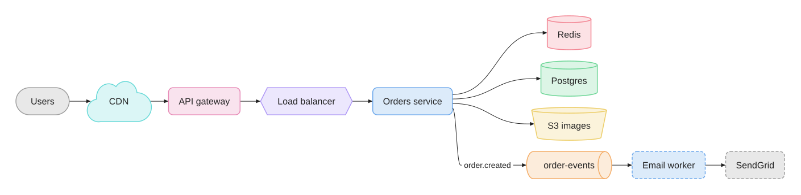
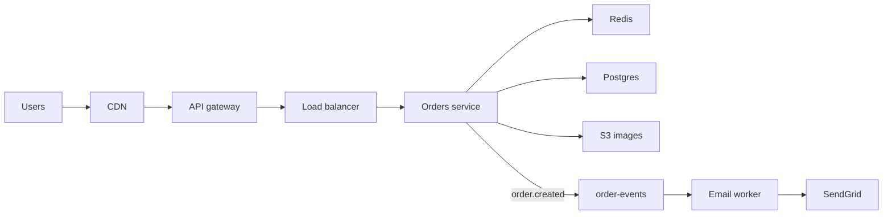
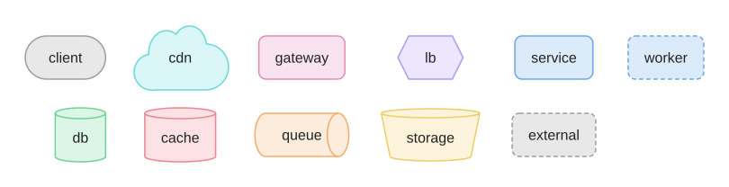
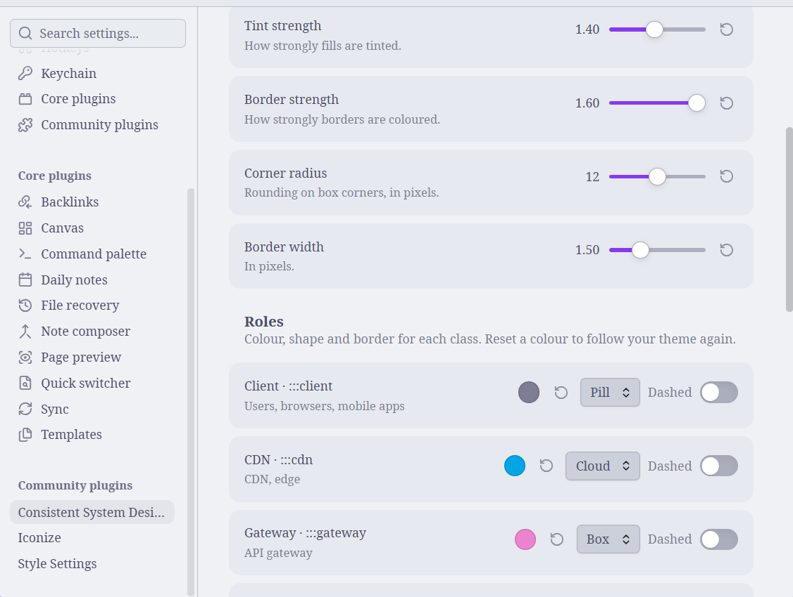
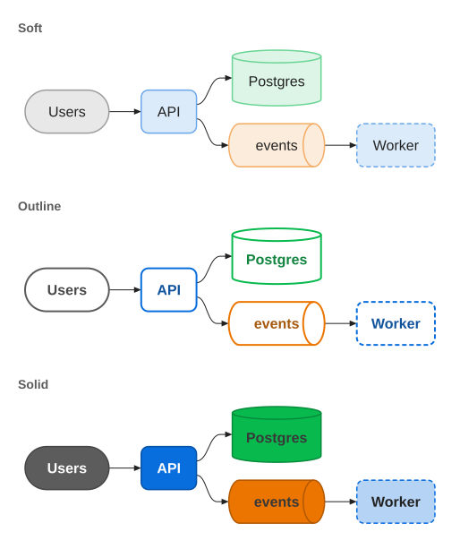
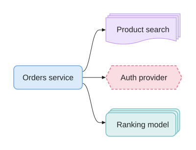
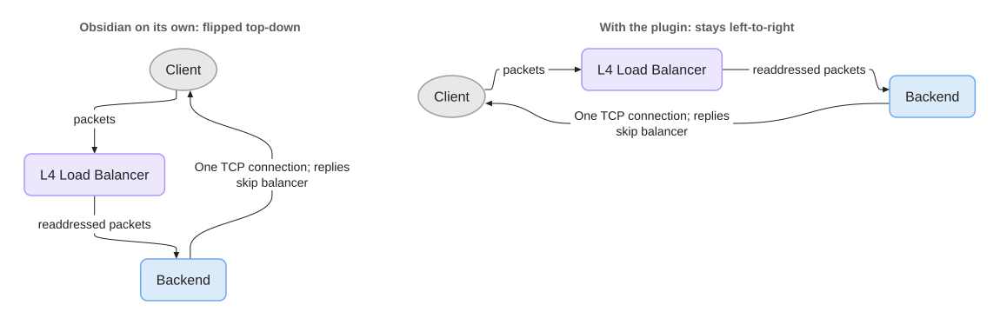

# Consistent System Design

Draw system design diagrams in Obsidian with consistent, theme-aware components. Tag a node with its role and it gets that role's colour and shape. Colours, shapes and borders are all adjustable, and you can add roles of your own.

<picture>
  <source media="(prefers-color-scheme: dark)" srcset="docs/images/architecture-dark.svg">
  
</picture>

That diagram is just this, with no styling of its own:

````markdown

````

The plugin also stops Obsidian from turning wide left-to-right diagrams into top-down ones.

Requires Obsidian 1.15 or later, which draws diagrams with [Pele](https://github.com/obsidianmd/pele).

## Components

| Class | For | Look | Automatic shape |
|---|---|---|---|
| `client` | users, browsers, mobile apps | grey | pill |
| `cdn` | CDN, edge | cyan | cloud |
| `gateway` | API gateway | pink | box |
| `lb` | load balancer | purple | hexagon |
| `service` | app or API service | blue | box |
| `worker` | async worker, background job | blue, dashed border | box |
| `db` | database | green | cylinder |
| `cache` | Redis, Memcached | red | cylinder |
| `queue` | queue or stream (Kafka, SQS) | orange | horizontal cylinder |
| `storage` | object or blob storage | yellow | bucket |
| `external` | third-party service | grey, dashed border | box |

<picture>
  <source media="(prefers-color-scheme: dark)" srcset="docs/images/roles-dark.svg">
  
</picture>

Colours come from your theme's `--color-*` variables, so they follow light and dark mode and theme changes.

You can also tag nodes with a `class` statement:

```
class PG,Orders db
```

## Automatic shapes

A tagged node gets its role's shape only when you haven't given it one: `PG[Postgres]:::db` and `PG:::db` become cylinders. A shape you write yourself always wins, so `PG{{Postgres}}:::db` stays a hexagon.

To skip one diagram, add this line to it:

```
%% csd: no-shapes
```

To turn the feature off everywhere, use **Settings → Consistent System Design → Automatic shapes**.

How it works: before Pele draws a flowchart, the plugin appends a line such as `PG@{ shape: cyl }` for each tagged node without a shape. Your note is never changed.

Labels that contain brackets need quotes, as they always do in Mermaid syntax: `PG["Postgres (main)"]:::db`.

## Customising

### Settings page

**Settings → Consistent System Design** has everything, with no other plugin needed:



- **Look:** Soft (tinted fill, the default), Outline (coloured border and text) or Solid (filled with the role colour; text turns dark or light to suit each colour).
- **Sliders:** tint strength, border strength, corner radius and border width.
- **Roles:** for each built-in role, a colour, a shape and a dashed-border toggle. Reset a colour to follow your theme again.
- **Custom roles:** add your own classes, such as `search`, `auth` or `ml-model`, each with a colour, shape and border. Use them like the built-in ones: `Index[Search]:::search`.
- **Reset styling** puts the look, sliders and built-in roles back to their defaults and keeps your custom roles.

Colour changes apply straight away. Shape changes show the next time a note is opened. Settings are saved per vault.

The three looks:

<picture>
  <source media="(prefers-color-scheme: dark)" srcset="docs/images/looks-dark.svg">
  
</picture>

Custom roles `search` (stacked documents), `auth` (dashed hexagon) and `ml-model` (stacked boxes):

<picture>
  <source media="(prefers-color-scheme: dark)" srcset="docs/images/custom-roles-dark.svg">
  
</picture>

### Style Settings

With the [Style Settings](https://github.com/mgmeyers/obsidian-style-settings) plugin, **Style Settings → Consistent System Design** offers the look, the four sliders and a colour per built-in role, each with separate light and dark values. If the same thing is set in both places, the plugin's own settings page wins.

### CSS snippet

Every value is a CSS variable you can override in your own snippet:

```css
body {
  --csd-db-color: teal;        /* any role: --csd-<role>-color */
  --csd-worker-dash: none;     /* any role: --csd-<role>-dash, e.g. "5 3" */
  --csd-fill-scale: 1.5;       /* tint strength, 1 = default */
  --csd-stroke-scale: 1;       /* border strength, 1 = default */
  --csd-radius: 4px;
  --csd-border-width: 2px;
}
```

Custom roles have the same variables: `--csd-search-color`, `--csd-search-dash`.

Order of precedence: the plugin's settings page, then Style Settings, then your snippet, then the defaults.

## Keep diagram direction

When a left-to-right diagram is wider than the note, Pele redraws it top-down. With this setting on (the default), the diagram keeps the direction you wrote and is scaled down to fit. Turn it off in **Settings → Consistent System Design**.

<picture>
  <source media="(prefers-color-scheme: dark)" srcset="docs/images/direction-dark.svg">
  
</picture>

How it works: Obsidian draws each diagram by calling Pele's `mount()`. The plugin wraps that call and passes Pele's own `autoDirection: false` option. It restores Pele when the plugin is disabled. If a future Obsidian version draws diagrams differently, this setting stops having an effect, but your diagrams keep working.

## Compatibility

- Diagrams that don't use these classes look exactly as before.
- Colours set inside a diagram with `classDef` or `style` win over the plugin's colours.
- Works alongside other plugins that wrap Pele, such as Mermaid Flow Enhancer.

## Privacy

The plugin makes no network requests and collects no data.

## Installing manually

Download `main.js`, `manifest.json` and `styles.css` from the latest release into `<vault>/.obsidian/plugins/consistent-system-design/`, then enable the plugin in **Settings → Community plugins**.

## License

[MIT](LICENSE)
