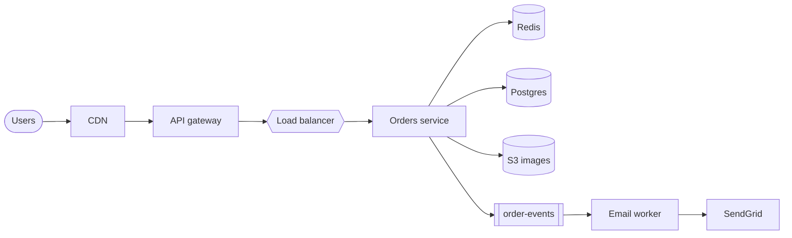

# Consistent System Design

Draw system design diagrams in Obsidian with consistent, theme-aware components. Tag a node with its role and it gets that role's colour:

````markdown

````

The plugin also stops Obsidian from turning wide left-to-right diagrams into top-down ones.

Requires Obsidian 1.15 or later, which draws diagrams with [Pele](https://github.com/obsidianmd/pele).

## Components

| Class | For | Look | Shape to pair it with |
|---|---|---|---|
| `client` | users, browsers, mobile apps | grey | pill (automatic) or `([ ])` |
| `cdn` | CDN, edge | cyan | `[ ]` |
| `gateway` | API gateway | pink | `[ ]` |
| `lb` | load balancer | purple | `{{ }}` |
| `service` | app or API service | blue | `[ ]` |
| `worker` | async worker, background job | blue, dashed border | `[ ]` |
| `db` | database | green | `[( )]` |
| `cache` | Redis, Memcached | red | `[( )]` |
| `queue` | queue or stream (Kafka, SQS) | orange | `[[ ]]` |
| `storage` | object or blob storage | yellow | `[( )]` |
| `external` | third-party service | grey, dashed border | `[ ]` |

Colours come from your theme's `--color-*` variables, so they follow light and dark mode and theme changes.

The class sets colour, border and corner radius. It can't change a node's shape, so write `[(Postgres)]` if you want a cylinder. The exception is `client`: a plain box becomes a pill.

You can also tag nodes with a `class` statement:

```
class PG,Orders db
```

## Looks

Three looks are included: **Soft** (tinted fill, the default), **Outline** (coloured border and text) and **Solid** (filled with the role colour). With the [Style Settings](https://github.com/mgmeyers/obsidian-style-settings) plugin, choose one under **Style Settings → Consistent System Design**. Without it, components use Soft.

## Keep diagram direction

When a left-to-right diagram is wider than the note, Pele redraws it top-down. With this setting on (the default), the diagram keeps the direction you wrote and is scaled down to fit. Turn it off in **Settings → Consistent System Design**.

How it works: Obsidian draws each diagram by calling Pele's `mount()`. The plugin wraps that call and passes Pele's own `autoDirection: false` option. It restores Pele when the plugin is disabled. If a future Obsidian version draws diagrams differently, this setting stops having an effect, but your diagrams keep working.

## Compatibility

- Diagrams that don't use these classes look exactly as before.
- Colours set inside a diagram with `classDef` or `style` win over the plugin's colours.
- Works alongside other plugins that wrap Pele, such as Mermaid Flow Enhancer.

## Privacy

The plugin makes no network requests and collects no data.

## Installing manually

Download `main.js`, `manifest.json` and `styles.css` from the latest release into `<vault>/.obsidian/plugins/consistent-system-design/`, then enable the plugin in **Settings → Community plugins**.

## License

[MIT](LICENSE)
